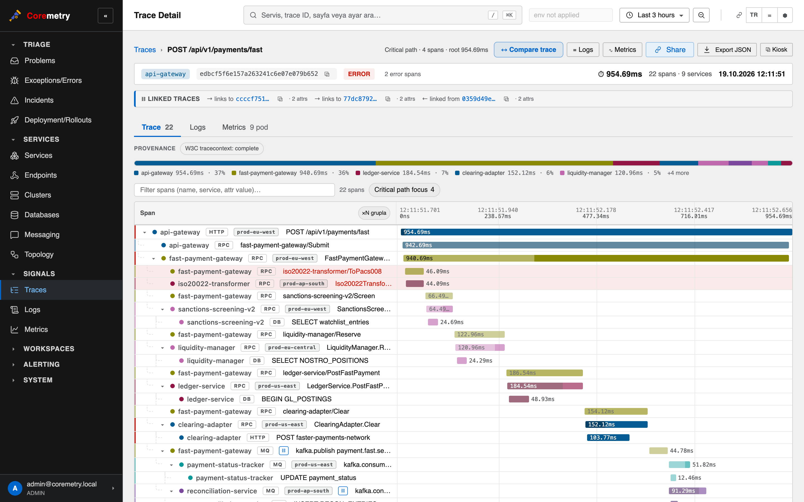
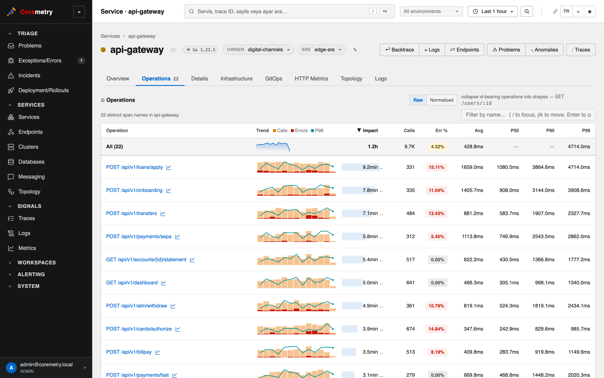
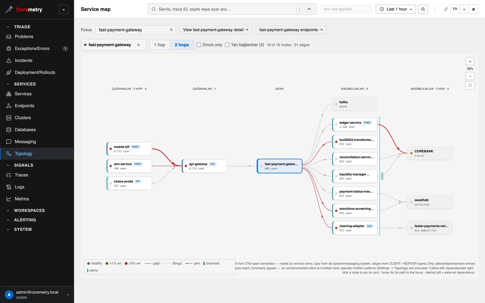
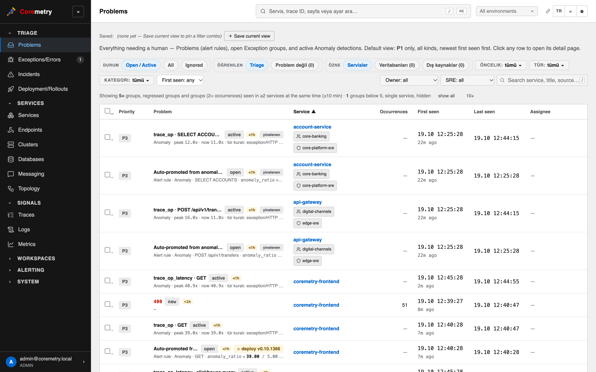
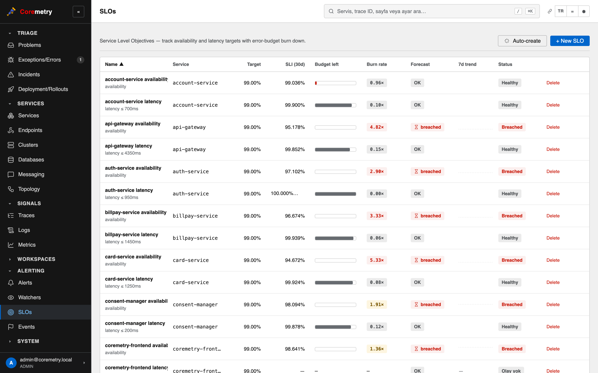
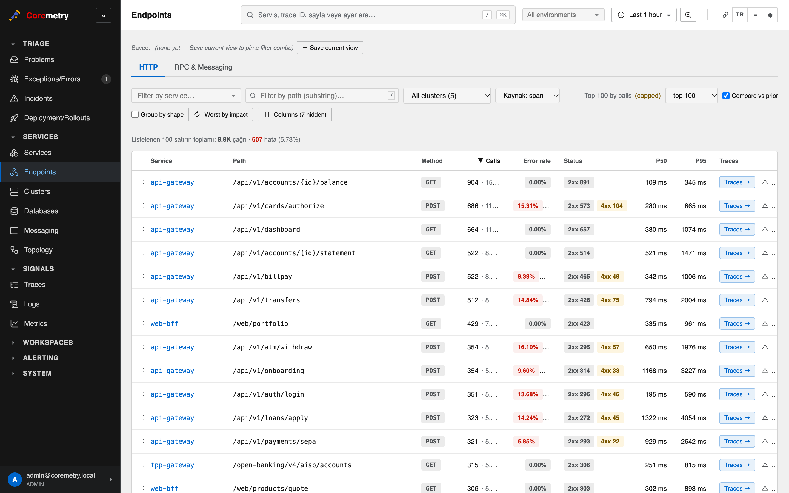
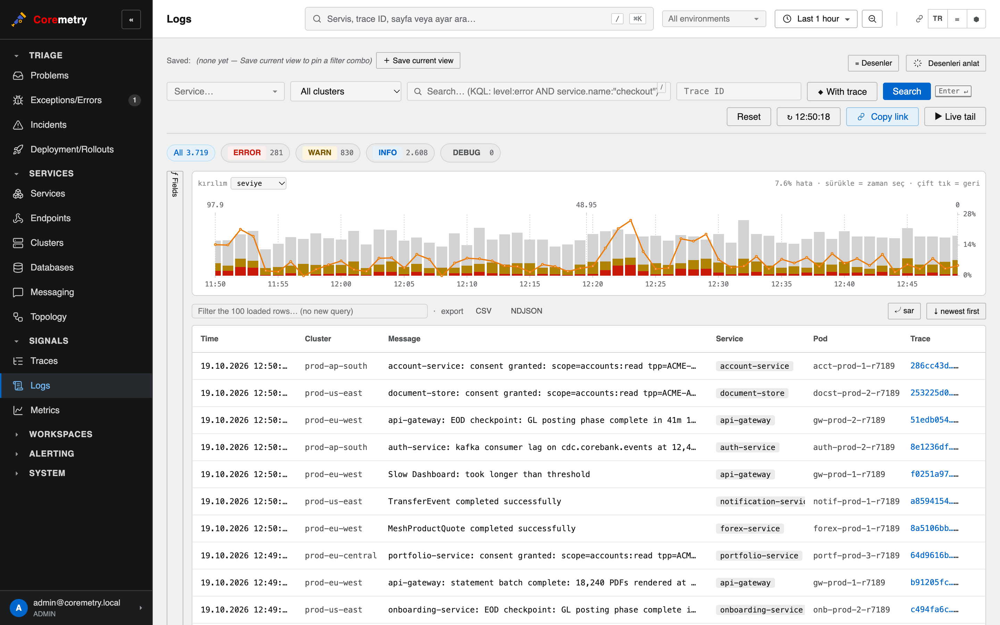
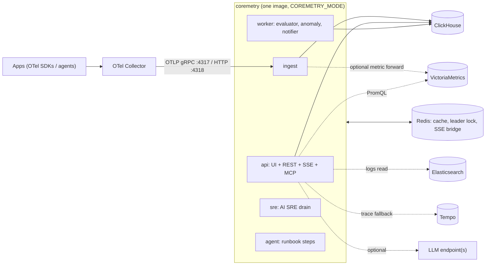

# Coremetry

[](https://github.com/cosretr/coremetry/actions/workflows/ci.yml)
[](https://github.com/cosretr/coremetry/releases)
[](LICENSE)
[](https://goreportcard.com/report/github.com/cosretr/coremetry)

**Open-source, OpenTelemetry-native APM with a built-in AI SRE assistant.**

Coremetry takes OTLP over gRPC and HTTP, with no proprietary agent or SDK,
and keeps traces, logs and span-derived aggregates in **ClickHouse**. Metrics are read with
**PromQL**, either from ClickHouse or from an external **VictoriaMetrics**
or other Prometheus-compatible store. Logs come from ClickHouse or an existing
**Elasticsearch** cluster and are joined to traces by `trace_id`. A
**Tempo** backend can serve as the fallback for traces that were sampled out
before they reached Coremetry. All of this ships as one Go binary with the
web UI embedded and is installed with one Helm chart.

<p align="center">
  <a href="docs/screenshots/trace-waterfall.png"></a>
</p>

| | |
|---|---|
| [](docs/screenshots/dashboard.png) **Per-operation RED view of a service** | [](docs/screenshots/service-graph.png) **Service map built from trace edges** |
| [](docs/screenshots/problems.png) **Problems inbox: anomalies, alert rules and exception groups, prioritised** | [](docs/screenshots/slos.png) **SLOs with error-budget burn rate** |
| [](docs/screenshots/endpoints.png) **Endpoints across services: error rate, status mix, latency** | [](docs/screenshots/logs.png) **Logs with level histogram, KQL search and trace links** |

More in [`docs/screenshots/`](docs/screenshots/): services list, profiling
flamegraph, login.

---

## Contents

- [Features](#features)
- [Architecture](#architecture)
- [Quick start (docker compose)](#quick-start-docker-compose)
- [Production install (Helm)](#production-install-helm)
- [Configuration essentials](#configuration-essentials)
- [Sending data](#sending-data)
- [Development](#development)
- [License](#license) · [Status](#status)

---

## Features

### Traces

- Trace waterfall with the critical path highlighted, the error chain
  (which downstream call failed first) and span-to-log and span-to-pod pivots.
- A side-by-side trace compare that diffs each operation.
- Trace search by service, operation, attributes, duration and errors,
  plus a volume strip and CSV export.
- Trace links you can share, and a read-only public trace snapshot.
- A Tempo-compatible `/api/traces/{id}` endpoint for Grafana. When Tempo is configured
  (Settings › Tempo backend), traces missing from ClickHouse are looked up in Tempo.

### Services, endpoints, operations

- A services catalogue with RED metrics (rate, errors, duration), runtime badges,
  team ownership and pinning.
- Each service page has these tabs: Overview, Operations, Endpoints, HTTP
  Metrics (PromQL panels), Infrastructure (clusters and pods inline),
  Topology, Exceptions, Logs and Deployments.
- Endpoint detail shows a "where the time goes" breakdown, the latency
  percentiles and a split by cluster and environment.
- Databases (statements and slow queries), external dependencies, hosts,
  Kubernetes clusters, namespaces and pods, and Kafka messaging (topics and
  consumer lag).
- A unified search page (`/search`), a command palette and a guided in-app tour.

### Metrics

- OTLP metrics ingest, with RED metrics derived from spans and kept in
  ClickHouse materialized views.
- A PromQL engine over the ClickHouse metric store. External reads come
  from VictoriaMetrics or another Prometheus-compatible API, and from Thanos
  Querier for remote clusters (Settings › Metric backend / Remote clusters).
  Incoming OTLP metrics can optionally be forwarded to VictoriaMetrics.
- An Explore view with a PromQL editor whose suggestions come from the
  selected source, and a pipe-style query language (DQL) over spans and metrics.

### Logs

- OTLP logs are stored in ClickHouse with a token bloom-filter index on the
  body. The read path can instead point at an existing Elasticsearch
  cluster (read-only user, `_msearch` batching).
- Logs are joined to traces by `trace_id`. The view has a Lucene/KQL-subset search,
  a level histogram, live tail, surrounding context and saved searches.
- Log patterns (Drain templates), significant terms, and a deep link to Kibana.

### Problems, anomalies, exceptions

- A **Problems inbox** that ranks issues P1/P2/P3. Every problem carries a
  plain-language reason: alert rules, anomalies and exception groups land
  in one list.
- **Exception groups** with fingerprinting, occurrence bands, sample traces
  with their logs, and resolve and ignore actions.
- **Anomaly detection**: log-pattern detectors (curated regexes, new templates,
  batch patterns), per-operation error and latency anomalies, service slowdown,
  SLO burn and metric baselines. Elastic ML anomaly jobs can also be imported (read-only).
- **Incidents**: a topological correlator groups related problems into one incident.
- **SLOs** with error-budget burn rate. **Synthetic monitors** (HTTP probes)
  and heartbeats. Maintenance windows and a public status page.

### Topology

- A service map built from sampled trace edges, with hops counted from a
  focus service and namespace lanes.
- Kubernetes DNS and gateway hostnames resolve to the real service.
- One-hop topology cards appear inside CoSRE answers.

### Rollouts and Argo CD

- A rollouts timeline per workload, based on ReplicaSet and kube-state-metrics
  revisions. It shows when traffic moved, image changes and a workload
  filter, and links to the service.
- Argo CD integration covers hub and instance discovery and app sync status. Rollbacks are
  attributed to their git source through an Argo CD sync webhook.
- Deploy events and a deployment report. Change events also feed problem
  context. See [docs/DEPLOY-EVENTS.md](docs/DEPLOY-EVENTS.md).

### Dashboards

- Preset dashboards for the APM overview, service performance, HTTP services,
  databases, JVM, Node.js, Go runtime, Kafka, errors and exceptions, and dependencies.
  Presets are versioned, so upgrades re-seed them without losing your edits.
- Custom dashboards with uPlot panels, template variables (`$service`, …),
  sharable links that pin the time range, and a global auto-refresh picker.
- "Explain this chart" on any panel. Charts in a CoSRE answer can be added
  to a dashboard in one click.

### Alerts and notifications

- Alert rules over RED metrics and PromQL. Elasticsearch Watcher definitions
  can be imported as alert rules.
- Notification channels: email (SMTP), Slack, Mattermost, Microsoft Teams,
  Zoom Chat, generic webhook and WhatsApp (Twilio), each with a minimum
  severity. Team routing mails the owning team when a problem first opens.
- Runbooks with automated steps (HTTP, JavaScript or bash), which the
  isolated `agent` role executes.

### CoSRE: AI assistant

CoSRE is the chat assistant built into every page ("Ask CoSRE").

- **Guided intents.** Common questions are answered by deterministic,
  evidence-first intents before any free-form tool loop runs. Examples
  are service health, the service report, a team's latest exceptions,
  why an operation fails, endpoint and cluster comparisons, outbound
  calls, a pod or JVM resource review, topology and metric charts. Starter
  questions offer choices taken from live data.
- **Evidence.** Answers carry evidence chips that open the underlying query
  in Explore, Logs or Traces. Charts, tables and topology render inline, and
  turns are archived so history and shared chats redraw them.
- **Context.** CoSRE knows the current page (service, trace, exception, problem,
  log line, panel), and you can pivot across signals (trace → pod → JVM → logs).
- **Knowledge.** Answers can draw on wiki pages (Azure DevOps Server), uploaded
  documents (`.xlsx`, `.csv`, JSON, YAML, text) and RAG with cited sources.
  Code review can read the source of the failing operation through Azure
  DevOps code search. Rules and memory ("remember this") persist.
- **Model profiles.** You can configure up to 20 profiles for Anthropic,
  GitHub Copilot or **any OpenAI-compatible endpoint**. Self-hosted models
  such as Gemma and Qwen work through Ollama, vLLM or LM Studio. Admins pick a
  default and can map individual surfaces to a different profile. Each
  profile can set its own headers, TLS and tuning.
- **`localOnly` gate.** Source code and wiki content are sent only to a
  profile that an admin has marked "local (self-hosted) model". Without one,
  that content is not fetched at all.
- **AI SRE background investigations** run in the `sre` role. Open P1 and P2
  problems are queued for read-only investigation, and the results appear
  on the Problem page as a hypothesis card, timeline and verify/dismiss
  actions, plus a matched runbook and rollback text. This is
  **recommendation-only**: nothing is executed or changed. An evaluation
  harness replays past problems against a frozen set and compares runs.
- AI usage, latency and errors are recorded per call on the `/ai` page.
  Budget and retention controls live in Settings › CoSRE.

### MCP server

- A built-in [Model Context Protocol](https://modelcontextprotocol.io) server
  exposes **74 tools**. They are grouped into toolsets (services, traces,
  problems, changes, metrics, logs, knowledge, …), and each toolset can be
  switched on or off and shows a health status. The server also exposes
  resources (`coremetry://…`) and prompts.
- Transports are Streamable HTTP (`POST /api/mcp`) and legacy HTTP+SSE
  (`GET /api/mcp/sse` + `POST /api/mcp/messages`).
- Authentication uses the UI session or a service API token (Settings › API
  Tokens), with the same role checks as the REST API.
- **Outbound MCP client**: CoSRE can call tools on external MCP servers that
  you configure (Settings › MCP servers). A Grafana MCP example is in
  [`docker-compose.grafana-mcp.yml`](docker-compose.grafana-mcp.yml).

### Auth and administration

- Local accounts, **LDAP / Active Directory** (group-to-role mapping, LDAPS and
  StartTLS), **OIDC SSO** with presets for common IdPs and IdP logout, and a
  trusted-header mode for oauth2-proxy or IAP.
  Central permission service: [docs/SSO-PERMISSION-SERVICE.md](docs/SSO-PERMISSION-SERVICE.md).
- The **admin / editor / viewer** roles, plus custom roles that limit the pages a
  viewer can see. Viewers see everything read-only.
- An append-only audit log for every admin write, and backup and restore of
  settings.
- Ingest pipeline rules (drop, enrich, sample) and data retention, editable in
  the UI.
- An admin-only, read-only SQL console with role and allow-list checks.
  ClickHouse runs it as `readonly` with an execution cap.
- Branding, themes (dark, light, corporate), announcement banner.

### Self-observability

- Coremetry traces itself over OTLP (`COREMETRY_SELF_OBS_*`), and the web UI
  ships browser traces through the OpenTelemetry JS SDK.
- Its own metrics (api, worker, ingest) go to the configured VictoriaMetrics,
  so its service page renders like any other.
- `/system` shows ingest, store and worker stats, and `/ai` shows AI calls.

---

## Architecture



**One binary, six roles.** The same image runs every role. `COREMETRY_MODE` picks it
([`main.go`](main.go) `parseRunModeValue`):

| Mode | Runs |
|---|---|
| `all` (default) | Everything in one process, including the AI SRE drain. Use it for POC or small installs. |
| `ingest` | OTLP gRPC/HTTP receivers and the ClickHouse writers. Scales horizontally. |
| `api` | Web UI, REST API, SSE event stream and MCP server. Scales horizontally. |
| `worker` | Alert evaluator, anomaly detectors, topology aggregation, notifier, AI SRE enqueue. Background jobs are leader-elected through a Redis lock. |
| `agent` | Runs automated runbook steps in an isolated pod. Each step is claimed through a Redis lock. |
| `sre` | AI SRE investigation drain. Reads only and never writes problems. |

**Dependencies**

| | Required? | Role |
|---|---|---|
| ClickHouse 24+ | **required** | Warm store for spans, logs, metrics, profiles and saved state. Reads go through materialized views first. A distributed cluster (`ON CLUSTER`, Replicated + Distributed tables) is supported, see [docs/clickhouse-cluster.md](docs/clickhouse-cluster.md). |
| Redis 7+ | required for more than one replica or distributed mode | L2 cache, leader lock, cross-pod SSE bridge. Without it, Coremetry runs single-instance and always holds the lock. |
| OTel Collector | recommended | Fan-in, batching, and optional head sampling (Coremetry stores 100% of what it receives). |
| VictoriaMetrics / Prometheus-compatible store, Thanos | optional | PromQL metric reads, plus remote clusters through Thanos. |
| Elasticsearch | optional | Log read backend. |
| Tempo | optional | Trace-by-id fallback for traces sampled out before Coremetry. |
| LLM endpoint | optional | CoSRE and AI SRE. With no key configured, the AI features stay hidden. |

Schema reference: [docs/SCHEMA.md](docs/SCHEMA.md). Architectural decisions:
[docs/DECISIONS.md](docs/DECISIONS.md).

---

## Quick start (docker compose)

```bash
git clone https://github.com/cosretr/coremetry
cd coremetry
docker compose up -d --build                  # core: coremetry, clickhouse, redis, elasticsearch, otel-collector
docker compose --profile demo up -d --build   # + Tempo, Grafana, Pyroscope and the Java/Go demo apps
```

The Makefile has the same two commands: `make docker-up` and `make docker-up-demo`.

- Web UI: <http://localhost:8088>. Sign in as `admin@coremetry.local` / `admin`,
  or set `COREMETRY_INITIAL_PASSWORD` in `.env` first.
- OTLP for your own apps goes to the collector at `localhost:14317` (gRPC) or
  `localhost:14318` (HTTP).
- In the compose stack, logs are read from the bundled Elasticsearch
  (`COREMETRY_LOGS_BACKEND=elasticsearch`). The collector sends 30% of traces
  to Coremetry and 100% to Tempo.
- To enable CoSRE, set `COREMETRY_AI_API_KEY` (plus `COREMETRY_AI_PROVIDER` /
  `COREMETRY_AI_BASE_URL` for an OpenAI-compatible endpoint), or add a model
  profile under Settings › CoSRE.

A distributed overlay is also available (`make docker-distributed-up`). The full
local guide, including ports, the dev loop and minikube, is in [docs/local-dev.md](docs/local-dev.md).

---

## Production install (Helm)

The chart in [`charts/coremetry`](charts/coremetry) is the supported install
path. Each release publishes it as an OCI artifact, and chart versions are
**un-prefixed** (`0.10.1462`, not `v0.10.1462`):

```bash
helm upgrade --install coremetry oci://ghcr.io/cosretr/charts/coremetry \
  --version <version> \
  --namespace coremetry --create-namespace \
  --set secrets.jwtSecret="$(openssl rand -hex 32)" \
  --set secrets.initialAdminPassword="<choose-a-password>"
```

By default this brings up a **monolithic** Coremetry Deployment plus a bundled
single-node ClickHouse, Redis and OTel Collector. You can also install from a
checkout with `helm install coremetry charts/coremetry …`.

**Distributed topology.** You switch to it by changing values and doing a
rolling upgrade:

```bash
  --set deployment.mode=distributed \
  --set deployment.roles.ingest.replicas=3 \
  --set deployment.roles.api.replicas=2 \
  --set deployment.roles.agent.enabled=true      # worker stays at 1; sre is on by default
```

This renders `coremetry-ingest`, `coremetry-api`, `coremetry-worker` (keep it at 1),
`coremetry-sre` and, if enabled, `coremetry-agent`. The stable `coremetry`
Service aliases the api role, so point your Ingress or Route at it.
Distributed mode requires Redis.

**External ClickHouse and Redis**

```bash
  --set clickhouse.enabled=false \
  --set clickhouse.external.addr="ch1:9000,ch2:9000,ch3:9000" \
  --set secrets.clickHousePassword="<password>" \
  --set redis.enabled=false \
  --set redis.external.url="redis://redis.example.internal:6379/0"
```

The driver round-robins and fails over across the seed list, so no load
balancer is needed. Use `clickhouse.secure=true` for native TLS (9440).

**Elasticsearch log reads** (Elasticsearch is not bundled):

```bash
  --set logs.backend=elasticsearch \
  --set 'logs.elasticsearch.addresses={https://es.example.internal:9200}' \
  --set logs.elasticsearch.index="logs-otel-default" \
  --set secrets.esApiKey="<base64 id:api_key>"
```

**Other knobs**

- `ingress.*` (Kubernetes) or `route.*` (OpenShift, edge TLS).
- `autoscaling.*` (the HPA targets the api role).
- `secrets.existingSecret` to use a Secret you manage.
- `extraEnv` / `envFrom` for integration tokens.
- `clickhouse.resetSchema=true` is **destructive** and runs on pre-install only.

Every key is documented inline in [`values.yaml`](charts/coremetry/values.yaml).
More guides: [charts/coremetry/README.md](charts/coremetry/README.md), the
OpenShift distributed guide
[charts/coremetry/docs/openshift-distributed.md](charts/coremetry/docs/openshift-distributed.md)
(restricted-v2 SCC, air-gapped registries, MCP session affinity), and flat
manifests in [`examples/openshift/`](examples/openshift/README.md).

---

## Configuration essentials

Configuration is resolved in this order: env > `config.yaml` > built-in
default. Every variable is listed in [docs/ENV.md](docs/ENV.md). Integrations
such as Tempo, VictoriaMetrics/Thanos, Argo CD, LDAP, OIDC, AI profiles, MCP
servers, wiki and code search are configured live in **Settings**. They are
stored in ClickHouse `system_settings` and apply without a restart.

| Variable | Purpose |
|---|---|
| `COREMETRY_MODE` | `all` \| `ingest` \| `api` \| `worker` \| `agent` \| `sre` |
| `COREMETRY_CH_ADDR`, `_DATABASE`, `_USERNAME`, `_PASSWORD`, `_SECURE`, `_CLUSTER_NAME` | ClickHouse connection (comma-separated seeds) and distributed mode |
| `COREMETRY_REDIS_URL` | Cache, leader lock and SSE bridge (empty means single-instance) |
| `COREMETRY_JWT_SECRET` | Session signing key. **Set it in production.** If empty, a new key is generated on every boot. |
| `COREMETRY_INITIAL_ADMIN`, `COREMETRY_INITIAL_PASSWORD` | Bootstrap admin (only used on first boot) |
| `COREMETRY_PUBLIC_URL` | External URL used for deep links in notifications |
| `COREMETRY_LOGS_BACKEND`, `COREMETRY_ES_*` | `clickhouse` (default) or `elasticsearch`, plus ES address, index and credentials |
| `COREMETRY_OIDC_*`, `COREMETRY_TRUSTED_HEADER_*` | SSO bootstrap (the Settings › SSO entry overrides these) |
| `COREMETRY_AI_PROVIDER`, `_API_KEY`, `_MODEL`, `_BASE_URL` | Default AI profile (`anthropic` \| `github` \| `openai`-compatible) |
| `COREMETRY_SELF_OBS_OTLP_ENDPOINT`, `_SAMPLE_RATE` | Self-tracing |
| `COREMETRY_HTTP_ADDR`, `COREMETRY_GRPC_ADDR`, `COREMETRY_OTLP_HTTP_ADDR` | Listeners (`:8088`, `:4317`, `:4318`) |

Retention, ingest batching and the rest of `config.yaml` are shown in
[`config.yaml`](config.yaml). The full schema is in
[`internal/config/config.go`](internal/config/config.go).

---

## Sending data

Point any OpenTelemetry SDK or collector at Coremetry, or at the bundled
collector, with standard settings:

```bash
OTEL_EXPORTER_OTLP_ENDPOINT=http://coremetry-otelcol:4317   # in-cluster collector (Helm)
OTEL_EXPORTER_OTLP_PROTOCOL=grpc
OTEL_SERVICE_NAME=checkout-service
OTEL_RESOURCE_ATTRIBUTES=deployment.environment.name=prod,service.version=1.4.2
```

The UI reads these resource attributes:

- `service.name` (required)
- `service.version` (deploy tracking)
- `deployment.environment.name` (environment filter)
- `telemetry.sdk.language` and `process.runtime.*` (runtime badge)
- `k8s.*` (pods, workloads, clusters)
- `host.name` (hosts)

Profiles are accepted from Pyroscope-compatible agents at `POST /ingest`.

---

## Development

Contributor docs, in reading order:

1. [CONTRIBUTING.md](CONTRIBUTING.md): gates, commit and tag format, PR template.
2. [docs/local-dev.md](docs/local-dev.md): prerequisites, compose stack, dev loop.
3. [docs/ENV.md](docs/ENV.md).
4. [SECURITY.md](SECURITY.md).
5. The codebase tour ([.claude/skills/codebase-tour/SKILL.md](.claude/skills/codebase-tour/SKILL.md)).
6. [CLAUDE.md](CLAUDE.md) for hard constraints and invariants.

Requirements are Go 1.26 (see `go.mod`) and Node 22. The binary embeds `frontend/dist`
through `//go:embed`, so build the UI once before `go build`:

```bash
make build-ui                                  # frontend → frontend/dist
go build ./... && ./coremetry --config config.yaml
cd frontend && npm run dev                     # Vite dev server, /api proxied to :8088
```

**Gates.** These run before every release, and CI runs the same set:

```bash
# frontend
cd frontend && npx tsc --noEmit && npx eslint src && TZ=UTC npx vitest run
# backend
go build ./... && go vet ./...
go test ./...
make audit                  # repo-specific static checks; a 🔴 finding blocks a tag
golangci-lint run ./...     # CI hard gate, pinned to golangci-lint v2.12.2 (.github/workflows/ci.yml)
```

CI also runs `go test -race` on the concurrency packages, a ClickHouse smoke
test, `helm lint`, govulncheck, npm audit and Trivy.

**Releases.** Every functional change ships as its own `v0.10.X` tag, and the tag
is the changelog. Pushing a tag builds the image and the OCI Helm chart
([`.github/workflows/release.yml`](.github/workflows/release.yml)). The flow is
described in [CONTRIBUTING.md](CONTRIBUTING.md) and the `/release` skill
([.claude/skills/release](.claude/skills/release)). The 1.0 cut procedure is in
[docs/RELEASE-1.0.md](docs/RELEASE-1.0.md).

---

## License

[Apache License 2.0](LICENSE), the same license as OpenTelemetry. You may use,
modify and redistribute Coremetry, commercially or not, under an explicit
patent grant from contributors. See [NOTICE](NOTICE) for attribution.

## Status

Active development, pre-1.0. See
[Releases](https://github.com/cosretr/coremetry/releases) for the per-version
changelog. Issues and feature requests are welcome on GitHub Issues.
